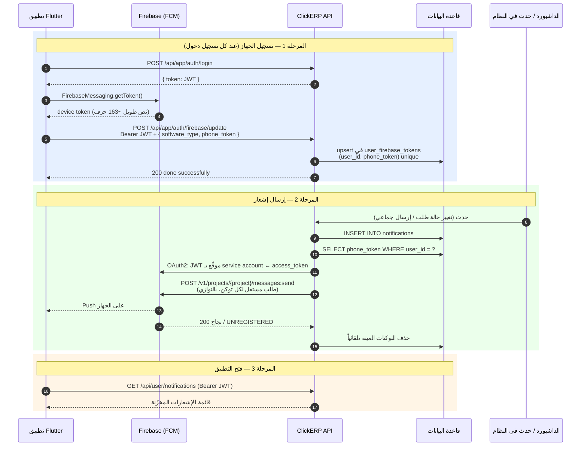
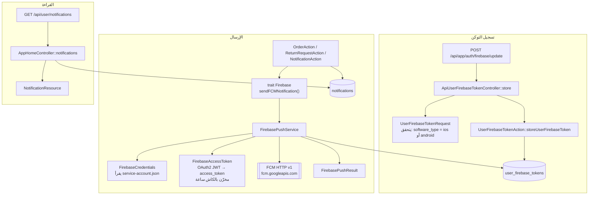
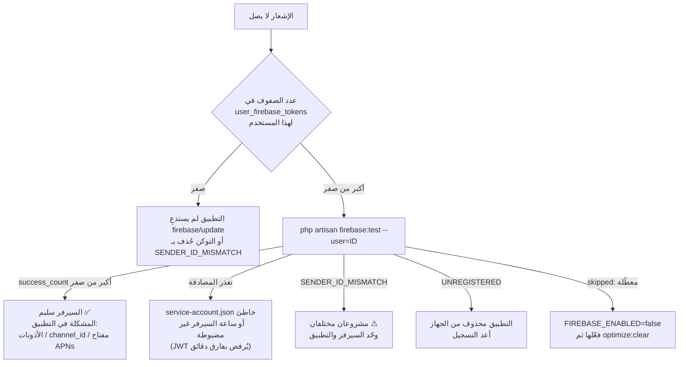

# إشعارات تطبيق الجوال عبر Firebase (FCM)

> مرجع لمطوّر الباك-إند ومطوّر Flutter معاً. يشرح: ما هي الإشعارات في النظام، كيف تُربط بـ Firebase
> وبالتطبيق، ما المطلوب من لوحة Firebase، وكيف تُختبر الـ APIs في Postman.
>
> آخر تحقّق من المحتوى مقابل الكود: 2026-09-01 (فرع `3mer`).

---

## 1. ما هي "الإشعارات" هنا؟

في هذا النظام كلمة "إشعار" تعني **شيئين منفصلين** يحدثان عادةً معاً، ومن المهم عدم الخلط بينهما:

| | (أ) سجلّ الإشعار في قاعدة البيانات | (ب) الإشعار الفوري (Push) |
|---|---|---|
| أين يعيش | جدول `notifications` | خوادم Google FCM ← جهاز المستخدم |
| من يقرأه | التطبيق عبر `GET /api/user/notifications` | نظام التشغيل يعرضه في شريط الإشعارات |
| يبقى بعد إغلاق التطبيق | نعم، دائم | لا، مجرد رسالة عابرة |
| يعمل بدون Firebase | نعم | لا |

الكود يكتب الاثنين في نفس اللحظة: يُنشئ صفّاً في `notifications` ثم يستدعي `sendFCMNotification(...)`.
لذلك **قائمة الإشعارات داخل التطبيق تعمل حتى لو كان Firebase معطّلاً تماماً** — الذي يتعطّل هو ظهور
الإشعار على شاشة الجهاز فقط.

### أنواع الإشعارات — `App\Enums\ingaz\NotificationActionEnum`

| القيمة | متى تُنشأ | الملف |
|---|---|---|
| `new_order` | إنشاء طلب جديد | [OrderAction::StoreNotification](../app/Http/Actions/ingaz/OrderAction.php#L143) |
| `order_status` | تغيير حالة الطلب / طلب إرجاع (إرسال، قبول، رفض) | [OrderAction::updateOrderStatus](../app/Http/Actions/ingaz/OrderAction.php#L165)، [ReturnRequestAction](../app/Http/Actions/ingaz/ReturnRequestAction.php#L25) |
| `general` | إرسال يدوي من الداشبورد لكل العملاء أو لمجموعة | [NotificationAction::storeGeneralNotifications](../app/Http/Actions/ingaz/NotificationAction.php#L432) |
| `sms` | سجلّ فقط لرسالة SMS/واتساب أُرسلت (لا Push) | [StoreMessageTrait](../app/Http/Traits/StoreMessageTrait.php) |
| `saved` | غير مستخدم حالياً في الكود | — |

**مهم:** أنواع `sms` و`whatsapp` تُسجَّل في نفس الجدول لكنها **لا ترسل Push**. هي مجرد أرشيف
لما أُرسل للعميل عبر قنوات أخرى. أي أن `GET /api/user/notifications` يُرجع خليطاً من الاثنين،
والتطبيق يميّزها بحقل `type`.

---

## 2. اللوجيك الكامل: من الجهاز إلى الإشعار

### الرسم التوضيحي — دورة الحياة



### الخريطة المعمارية للملفات



### شرح الخطوات الحرجة

**لماذا OAuth2 وليس مفتاح سيرفر؟**
أغلقت Google واجهة FCM القديمة (`fcm.googleapis.com/fcm/send` + `Server key`) في يونيو 2024.
النظام يستخدم **FCM HTTP v1**: نوقّع JWT بالمفتاح الخاص لحساب الخدمة (RS256)، نبادله مع Google
بـ `access_token` صالح لساعة، ونخزّنه في الكاش
([FirebaseAccessToken](../app/Services/Firebase/FirebaseAccessToken.php)).

**لماذا طلب لكل توكن؟**
واجهة v1 لا تدعم `registration_ids` (إرسال جماعي في طلب واحد) كما كانت الـ Legacy. لذلك
[FirebasePushService](../app/Services/Firebase/FirebasePushService.php) يرسل عبر
`Http::pool` على دفعات متوازية بحجم `FIREBASE_CONCURRENCY` (افتراضياً 20).

**تنظيف التوكنات الميتة:**
إذا ردّت FCM بـ `UNREGISTERED` أو `SENDER_ID_MISMATCH` أو `INVALID_ARGUMENT`، يُحذف التوكن من
قاعدة البيانات تلقائياً (يُعطَّل بـ `FIREBASE_PRUNE_INVALID_TOKENS=false`).

**كل قيم `data` تُحوَّل إلى نصوص:** واجهة v1 ترفض الأرقام في `data` بـ `INVALID_ARGUMENT`،
لذلك `buildMessage()` يحوّلها صراحة.

### شكل الرسالة التي تصل إلى Flutter

```jsonc
{
  "notification": { "title": "…", "body": "…" },
  "data": {
    "type": "order_status",   // من NotificationActionEnum
    "order_id": "7327"        // نص وليس رقم — انتبه في Flutter
  },
  "android": {
    "priority": "high",
    "notification": { "channel_id": "default_channel", "sound": "default" }
  },
  "apns": { "payload": { "aps": { "sound": "default", "content-available": 1 } } }
}
```

مطوّر Flutter يستخدم `data.type` و`data.order_id` للتوجيه إلى الشاشة الصحيحة عند الضغط على الإشعار.
`channel_id` يجب أن يُنشأ فعلياً في التطبيق على أندرويد 8+ وإلا لن يظهر الإشعار.

---

## 3. الربط مع Firebase — ما المطلوب بالضبط

### ⚠️ تنبيه أول: هناك مشروعان مختلفان

| المصدر | المشروع |
|---|---|
| لقطة لوحة Firebase المرسلة | **AjeebQurtabah** — فيه تطبيقا `aqro_app (android)` و`aqro_app (ios)` |
| ملف `storage/app/firebase/service-account.json` الموجود في السيرفر | **`aqro-notifications`** |

هذان مشروعان منفصلان في Google. إذا كان تطبيق Flutter مبنياً على
`google-services.json` من مشروع **AjeebQurtabah**، فإن التوكنات التي يُصدرها تخصّ ذلك المشروع،
بينما السيرفر يرسل عبر مشروع `aqro-notifications` ← **كل إرسال سيفشل بـ `SENDER_ID_MISMATCH`،
وسيقوم النظام بحذف التوكن تلقائياً**، فتظهر قاعدة البيانات وكأنها فارغة دائماً.

**أول خطوة قبل أي اختبار:** حدّد المشروع الصحيح، ثم وحّد الطرفين عليه:

- إمّا نزّل `service-account.json` جديداً من **AjeebQurtabah** واستبدل الملف في السيرفر،
- أو أعد بناء تطبيق Flutter بـ `google-services.json` / `GoogleService-Info.plist` من
  **`aqro-notifications`**.

للتحقّق من المشروع الحالي في السيرفر:

```bash
php -r "echo json_decode(file_get_contents('storage/app/firebase/service-account.json'), true)['project_id'];"
```

### المطلوب من جهة السيرفر (Backend)

1. **تفعيل الـ API** — في لوحة Firebase: `⚙️ Settings ← Cloud Messaging` وتأكّد أن
   **Firebase Cloud Messaging API (V1)** حالته `Enabled`.

2. **ملف حساب الخدمة** — `⚙️ Project settings ← Service accounts ← Generate new private key`
   ينزّل ملف JSON. ضعه في:

   ```
   storage/app/firebase/service-account.json
   ```

   > ملف سرّي. لا يُرفع إلى git إطلاقاً — من يملكه يستطيع الإرسال باسم مشروعك.

3. **متغيّرات `.env`** — الموجود حالياً ناقص (ثلاثة أسطر فقط). الشكل الكامل:

   ```env
   FIREBASE_ENABLED=true
   FIREBASE_PROJECT_ID=            # اتركه فارغاً ليُقرأ من الملف
   FIREBASE_CREDENTIALS=storage/app/firebase/service-account.json
   FIREBASE_TIMEOUT=15
   FIREBASE_CONCURRENCY=20
   FIREBASE_TOKEN_CACHE_TTL=3300
   FIREBASE_PRUNE_INVALID_TOKENS=true
   FIREBASE_ANDROID_PRIORITY=high
   FIREBASE_ANDROID_CHANNEL_ID=default_channel
   FIREBASE_ANDROID_SOUND=default
   FIREBASE_APNS_SOUND=default
   ```

   ثم: `php artisan optimize:clear`

4. **الخروج للإنترنت** — السيرفر يجب أن يصل إلى `oauth2.googleapis.com` و`fcm.googleapis.com`
   عبر HTTPS. خلف Firewall مغلق سيفشل الإرسال بخطأ مصادقة.

### المطلوب من جهة التطبيق (Flutter)

| المنصّة | المطلوب |
|---|---|
| Android | `google-services.json` من نفس المشروع، وإنشاء Notification Channel باسم `default_channel` |
| iOS | `GoogleService-Info.plist`، ورفع **APNs Authentication Key (.p8)** إلى `Settings ← Cloud Messaging ← Apple app configuration`، وتفعيل Push Notifications + Background Modes في Xcode |

> بدون مفتاح APNs، إشعارات iOS **لن تصل أبداً** مهما كان السيرفر سليماً. هذه أكثر نقطة تُنسى.

وفي كود Flutter:

```dart
await FirebaseMessaging.instance.requestPermission();
final token = await FirebaseMessaging.instance.getToken();
await api.post('/api/app/auth/firebase/update', data: {
  'software_type': Platform.isIOS ? 'ios' : 'android',
  'phone_token': token,
});

// مهم: التوكن يتغيّر (إعادة تثبيت، مسح البيانات، تدوير دوري)
FirebaseMessaging.instance.onTokenRefresh.listen((t) => /* أعد الإرسال */);
```

**متى يُستدعى `firebase/update`؟** بعد كل تسجيل دخول ناجح، وعند كل `onTokenRefresh`.
الـ endpoint يستخدم `updateOrCreate` على `(user_id, phone_token)` فتكراره آمن تماماً.

---

## 4. هل الـ APIs تعمل؟ — نتيجة الفحص الفعلي

نعم، الطرفان يعملان. نُفّذت الطلبات فعلياً على قاعدة بيانات التطوير بتاريخ 2026-09-01:

| الاختبار | النتيجة |
|---|---|
| `GET /api/user/notifications` بدون توكن | `200` + `data: []` |
| `GET /api/user/notifications` بتوكن JWT صالح | `200` + الإشعارات مع كائني `order` و`user` |
| `POST /api/app/auth/firebase/update` ببيانات صحيحة | `200` + حُفظ الصف في `user_firebase_tokens` |
| `POST /api/app/auth/firebase/update` ببيانات خاطئة | `422` + رسائل تحقّق صحيحة |
| تكرار نفس التوكن مرتين | صفّ واحد فقط (فهرس unique يعمل) |

### لكن هناك أربع مشاكل حقيقية يجب معالجتها

#### (1) 🔴 جدول `user_firebase_tokens` فارغ تماماً — صفر صفوف

لا يوجد أي جهاز مسجّل في قاعدة بيانات التطوير. يعني ذلك أن **أيّ إشعار Push أُرسل حتى اليوم لم
يصل لأحد**؛ `FirebasePushService` يُرجع `skipped: "لا توجد توكنات مسجّلة للمستلمين"` بصمت
دون أي خطأ ظاهر. هذا متوقّع ما دام التطبيق لم يستدعِ `firebase/update` بعد، لكنه أيضاً نفس
العَرَض الذي سيظهر لو كان مشروع Firebase غير متطابق (انظر التنبيه في القسم 3).

#### (2) 🔴 العنوان والوصف يعودان فارغين لأي لغة غير التي أُنشئ بها الإشعار

`Notification` يستخدم `Spatie\Translatable` وحقلا `title`/`description` مخزّنان JSON. لكن
معظم الإشعارات تُنشأ عبر [`StoreMessageTrait::storeMessage`](../app/Http/Traits/StoreMessageTrait.php)
الذي يمرّر **نصاً عادياً**، فيُحفظ باللغة النشطة وقتها فقط:

```json
{"ar": "تحديث حالة الطلب"}
```

وميدلوير [`AppApiLang`](../app/Http/Middleware/AppApiLang.php) يضبط اللغة من هيدر `lang` أو
`Accept-Language`. النتيجة المُثبتة عملياً على الإشعار رقم 126:

```
lang: ar        →  title = "تحديث حالة الطلب"     ✅
lang: en        →  title = ""                      ❌ فارغ
بدون هيدر lang  →  title = ""                      ❌ (لأن Accept-Language للجهاز غالباً en-US)
```

**الأثر على Flutter:** قائمة إشعارات فارغة العناوين لأي مستخدم جهازه بالإنجليزية.

- **الحلّ العاجل (Flutter):** أرسل دائماً هيدر `lang: ar` مع كل طلب.
- **الحلّ الجذري (باك-إند):** إمّا كتابة اللغتين في `storeMessage`، أو إضافة fallback في
  `NotificationResource` يرجع لأول لغة متاحة عند فراغ اللغة المطلوبة.

#### (3) 🟠 الإشعار الجماعي "لكل العملاء" لا يظهر في قائمة التطبيق

في [`storeGeneralNotifications`](../app/Http/Actions/ingaz/NotificationAction.php#L432) عند اختيار
`all_or_some = all` يُحفظ **صفّ واحد** بـ `user_id = null`، بينما الـ Push يُرسل لكل المستخدمين.
لكن `GET /api/user/notifications` يفلتر بـ `where('user_id', $user->id)` — فالصفّ ذو `user_id = null`
لا يطابق أحداً. النتيجة: يصل الإشعار على الجهاز لكنه **يختفي عند فتح التطبيق**.

#### (4) 🟠 لا يوجد مفهوم "مقروء / غير مقروء"

أعمدة جدول `notifications` هي: `id, title, description, order_id, user_id, type, created_at, updated_at`.
لا يوجد `read_at` ولا endpoint للتعليم كمقروء. أي **لا يمكن بناء شارة العدّاد (badge)** في التطبيق
حالياً. يحتاج migration يضيف `read_at` + endpoint `POST /api/user/notifications/{id}/read`.

> ملاحظة جانبية غير متعلّقة بالإشعارات: `php artisan route:list` يفشل حالياً لأن
> [routes/web.php:15](../routes/web.php#L15) يستورد `App\Http\Controllers\Web\HomeController` وهو
> غير موجود. هذا يمنع أيضاً `route:cache`.

---

## 5. الاختبار في Postman

### التحضير — متغيّرات البيئة

| المتغيّر | القيمة |
|---|---|
| `base_url` | `http://127.0.0.1:8000` |
| `token` | يُملأ تلقائياً من ردّ تسجيل الدخول |

هيدرات ثابتة على كل الطلبات:

```
Accept: application/json
Content-Type: application/json
lang: ar
```

> `lang: ar` ليس اختيارياً — بدونه تعود عناوين الإشعارات فارغة (المشكلة رقم 2).

### الطلب 1 — تسجيل الدخول للحصول على JWT

```
POST {{base_url}}/api/app/auth/login
{
  "phone": "05xxxxxxxx",
  "password": "******"
}
```

الردّ:

```json
{ "status": true, "message": "…", "data": { "user": {}, "token": "eyJ0eXAi..." } }
```

في تبويب **Tests** احفظ التوكن تلقائياً:

```javascript
pm.environment.set("token", pm.response.json().data.token);
```

> الـ endpoint محمي بـ Rate Limit: 5 محاولات في الدقيقة لكل رقم جوال (يردّ `429`).

### الطلب 2 — تسجيل توكن الجهاز

```
POST {{base_url}}/api/app/auth/firebase/update
Authorization: Bearer {{token}}

{
  "software_type": "android",
  "phone_token": "ضع هنا التوكن الحقيقي من FirebaseMessaging.getToken()"
}
```

الردّ المتوقّع `200`:

```json
{
  "status": true,
  "code": 200,
  "data": { "software_type": "android", "phone_token": "…", "user_id": 4072 },
  "message": "done successfully"
}
```

حالات الفشل:

| الحالة | الردّ |
|---|---|
| بدون `Authorization` | `401 Unauthenticated` |
| `software_type` غير `ios`/`android` | `422` + `The selected software type is invalid.` |
| `phone_token` فارغ | `422` + `The phone token field is required.` |

للتأكّد من الحفظ:

```sql
SELECT id, user_id, software_type, LEFT(phone_token, 25) AS token, updated_at
FROM user_firebase_tokens ORDER BY id DESC LIMIT 10;
```

> **لا يمكن اختبار الإرسال الفعلي بتوكن وهمي.** التوكن الوهمي يُقبل في هذا الـ endpoint
> (لا يوجد تحقّق من صيغته) لكنه يفشل عند الإرسال بـ `INVALID_ARGUMENT`.
> من أين تأتي بالتوكن الحقيقي؟ ← القسم التالي.

### من أين أحصل على توكن الجهاز؟

**أولاً، تصحيح لبس شائع: لوحة Firebase لا تعرض توكنات الأجهزة إطلاقاً.** لا يوجد أي شاشة في
الـ Console تسرد الأجهزة المسجّلة. التوكن يُولَّد **على الجهاز نفسه** بواسطة الـ SDK، ولا يعرفه
السيرفر إلا إذا أرسله التطبيق إليه — وهذا بالضبط دور
`POST /api/app/auth/firebase/update`.

أمامك أربع طرق، مرتّبة من الأسهل:

#### الطريقة 1 — اطلبه من مطوّر Flutter (الأسرع)

يضيف سطراً واحداً بعد تهيئة Firebase ويرسل لك المخرَج:

```dart
final token = await FirebaseMessaging.instance.getToken();
debugPrint('FCM TOKEN => $token');
```

يظهر في `flutter run` أو في `adb logcat`. التوكن نصّ طويل (~163 حرفاً) فيه `:` بعد أول ~22 حرفاً،
مثل: `dQw4w9WgXcQ:APA91bF...`

#### الطريقة 2 — من قاعدة بياناتك بعد أن يعمل التطبيق (الطريقة الطبيعية)

بمجرّد أن يستدعي التطبيق `firebase/update` مرة واحدة، التوكن يصبح عندك:

```sql
SELECT u.id, u.name, u.phone, t.software_type, t.phone_token, t.updated_at
FROM user_firebase_tokens t
JOIN users u ON u.id = t.user_id
ORDER BY t.updated_at DESC
LIMIT 20;
```

عندها لا تحتاج نسخ التوكن أصلاً — استخدم `php artisan firebase:test --user=ID` مباشرةً.

> هذا هو المسار الصحيح. الجدول فارغ حالياً لأن التطبيق لم يستدعِ الـ endpoint بعد.

#### الطريقة 3 — محاكي أندرويد على جهازك

شغّل التطبيق على AVD يحتوي **Google Play Services** (صورة نظام باسم *Google APIs* أو
*Google Play*، وليس صورة AOSP العادية — بدونها `getToken()` يرجع `null`)، ثم:

```bash
adb logcat | grep -i "FCM TOKEN"
```

#### الطريقة 4 — صفحة ويب صغيرة، بدون تطبيق إطلاقاً ⭐

مفيدة جداً لك كمطوّر باك-إند: تولّد توكناً حقيقياً في دقيقتين وتتأكّد أن **جهة السيرفر سليمة**
قبل أن يجهز تطبيق Flutter.

**التحضير في لوحة Firebase (مرة واحدة):**

1. `⚙️ Project settings ← General ← Your apps ← Add app ← Web (</>)`
   — انسخ كائن `firebaseConfig` الذي يظهر.
2. `⚙️ Project settings ← Cloud Messaging ← Web configuration ← Web Push certificates
   ← Generate key pair` — انسخ **VAPID public key**.

**أنشئ مجلداً فيه ملفان:**

`index.html`

```html
<!doctype html>
<meta charset="utf-8">
<button onclick="go()">أظهر التوكن</button>
<pre id="out" style="white-space:pre-wrap;word-break:break-all"></pre>
<script src="https://www.gstatic.com/firebasejs/10.12.2/firebase-app-compat.js"></script>
<script src="https://www.gstatic.com/firebasejs/10.12.2/firebase-messaging-compat.js"></script>
<script>
const cfg = { /* الصق firebaseConfig هنا */ };
firebase.initializeApp(cfg);
async function go() {
  const out = document.getElementById('out');
  try {
    const reg = await navigator.serviceWorker.register('/firebase-messaging-sw.js');
    if (await Notification.requestPermission() !== 'granted') { out.textContent = 'رُفض الإذن'; return; }
    out.textContent = await firebase.messaging().getToken({
      vapidKey: 'الصق_VAPID_public_key_هنا',
      serviceWorkerRegistration: reg,
    });
  } catch (e) { out.textContent = 'خطأ: ' + e.message; }
}
</script>
```

`firebase-messaging-sw.js`

```js
importScripts('https://www.gstatic.com/firebasejs/10.12.2/firebase-app-compat.js');
importScripts('https://www.gstatic.com/firebasejs/10.12.2/firebase-messaging-compat.js');
firebase.initializeApp({ /* نفس firebaseConfig */ });
firebase.messaging();
```

**شغّلها:**

```bash
php -S localhost:8080     # من داخل المجلد
```

افتح `http://localhost:8080` واضغط الزر. (لا تفتح الملف بـ `file://` — الـ Service Worker
يتطلّب `localhost` أو HTTPS.)

**استخدم التوكن الناتج:**

```bash
php artisan firebase:test --token="التوكن_من_الصفحة" --title="تجربة" --body="من السيرفر"
```

لو ظهر `"success_count": 1` وظهر إشعار في المتصفّح — فجهة السيرفر (ملف حساب الخدمة،
المصادقة، الاتصال بـ FCM) سليمة 100٪، وأي مشكلة لاحقة تكون في التطبيق أو مفتاح APNs.

⚠️ ملاحظتان على هذه الطريقة:

- هذا **توكن ويب** وليس جهاز جوّال. لا ترسله عبر `POST /api/app/auth/firebase/update` لأن
  `software_type` يقبل `ios`/`android` فقط — استخدم `firebase:test --token=` مباشرةً.
- صفحة الويب يجب أن تكون في **نفس مشروع Firebase** الذي يستخدمه ملف `service-account.json`
  في السيرفر، وإلا ستحصل على `SENDER_ID_MISMATCH` (راجع تنبيه القسم 3).

#### الطريقة 5 — اختبار من اللوحة مباشرةً (لا يولّد توكناً)

`Engage ← Cloud Messaging ← Send test message` تطلب منك **لصق توكن** — أي أنها لا تساعدك في
الحصول عليه، لكنها مفيدة بعد أن تحصل عليه: لو نجحت من اللوحة وفشلت من السيرفر، فالمشكلة في
`service-account.json`؛ ولو فشلت من الاثنين، فالمشكلة في إعداد التطبيق نفسه.

### الطلب 3 — قراءة الإشعارات

```
GET {{base_url}}/api/user/notifications
Authorization: Bearer {{token}}
lang: ar
```

مع ترقيم الصفحات:

```
GET {{base_url}}/api/user/notifications?pagination=on&limit_per_page=10
```

الردّ:

```json
{
  "message": "All items",
  "code": 200,
  "data": [
    {
      "id": 127,
      "title": "تحديث حالة الطلب",
      "description": "تم تحديث حالة طلبك رقم 7327 إلى تحت الإجراء",
      "type": "order_status",
      "order_id": 7327,
      "order": {},
      "user_id": 4072,
      "user": {},
      "created_at": "2026-08-30 15:25:10"
    }
  ],
  "current_page": 1,
  "total": 127,
  "per_page": 10
}
```

⚠️ **انتبه لهذين السلوكين:**

- بدون `pagination=on` يرجع **كل** الإشعارات دفعة واحدة بدون حدّ أقصى.
- بدون `Authorization` صالح يرجع `200` مع `data: []` **وليس `401`** — لأن
  `resolveApiUser()` يبتلع الخطأ. لا تعتمد على رمز الحالة للتمييز بين "لا توجد إشعارات"
  و"التوكن منتهي".

### الطلب 4 — اختبار الإرسال الفعلي (الأهم)

الطريقة الأسرع للتأكّد أن السلسلة كاملة تعمل هي أمر artisan جاهز:

```bash
# إرسال لكل أجهزة مستخدم معيّن
php artisan firebase:test --user=4072 --title="تجربة" --body="رسالة من السيرفر"

# أو إرسال لتوكن جهاز محدّد مباشرة
php artisan firebase:test --token="التوكن_الحقيقي"
```

قراءة النتيجة:

| المخرَج | المعنى | الإجراء |
|---|---|---|
| `"success_count": 1` | ✅ وصل الإشعار للجهاز | — |
| `"skipped": true` + `لا توجد توكنات مسجّلة` | المستخدم لم يسجّل جهازاً | نفّذ الطلب 2 أولاً |
| `"skipped": true` + `تعذر المصادقة مع Firebase` | ملف حساب الخدمة خاطئ أو ساعة السيرفر غير مضبوطة | راجع القسم 3 |
| `SENDER_ID_MISMATCH` | التوكن من مشروع Firebase مختلف | **المشكلة المتوقّعة هنا** — راجع تنبيه القسم 3 |
| `UNREGISTERED` | التطبيق حُذف من الجهاز | طبيعي، حُذف التوكن تلقائياً |
| `INVALID_ARGUMENT` | التوكن ليس توكن FCM حقيقي | استخدم توكناً من التطبيق |

### الطلب 5 — إشعار Push جماعي من الداشبورد

مسار `general` هو الوحيد الذي يرسل Push من الداشبورد، وهو `notifications.store`
(`POST /dashboard/{locale}/…/sms-dispatch`) بـ `type` مخالف لـ `sms`/`whatsapp`:

```
type=general
title=عنوان
description=النص
all_or_some=some
user_id[]=4072
```

> **لا توجد شاشة في الداشبورد لهذا حالياً** — الشاشتان الموجودتان (`sms-dispatch`
> و`whatsapp-dispatch`) للرسائل النصية وواتساب فقط. الإرسال الجماعي عبر Push يحتاج
> استدعاءً مباشراً أو إضافة شاشة.

---

## 6. هل تظهر الإشعارات في لوحة Firebase؟

**لا، ولن تظهر.** هذه أكثر نقطة تسبّب لبساً:

| الطريقة | تظهر في `Messaging` بالـ Console؟ |
|---|---|
| **Notification Campaigns** (تُكتب يدوياً من اللوحة) | ✅ نعم، مع إحصاءات إرسال/فتح |
| **FCM HTTP v1 API** (ما يستخدمه هذا النظام) | ❌ **لا** — لا سجلّ ولا عدّاد |

الرسائل المرسلة برمجياً عبر الـ API لا تُسجَّل في `Engage ← Messaging`؛ لوحة Firebase تعرض
حملات اللوحة فقط. أيضاً لوحة **Analytics** الظاهرة في اللقطة تُظهر `No data` لأنها تحتاج حزمة
`firebase_analytics` مثبّتة في التطبيق، وهي منفصلة تماماً عن الإشعارات.

### أين تتحقّق فعلاً من الإرسال إذن؟

1. **مخرَج `php artisan firebase:test`** — المصدر الأدقّ (نجاح/فشل + السبب لكل توكن).
2. **`storage/logs/laravel.log`** — يسجّل `Firebase access token failed`،
   `Firebase pool dispatch failed`، و`Firebase pruned invalid device tokens`.
3. **الجهاز نفسه** — الاختبار النهائي الوحيد الموثوق.
4. **`Cloud Messaging ← Send test message`** في اللوحة — تلصق فيها توكن جهاز وترسل مباشرة.
   هذه تعزل المشكلة تماماً: لو نجحت هنا وفشلت من السيرفر، فالمشكلة في ملف حساب الخدمة؛
   ولو فشلت هنا أيضاً، فالمشكلة في إعداد التطبيق أو مفتاح APNs.

---

## 7. خطة التشخيص عند "الإشعارات لا تصل"

نفّذها بالترتيب — كل خطوة تعزل طبقة واحدة:



**فحوصات سريعة إضافية:**

```bash
# هل الإعدادات مقروءة فعلاً؟
php artisan tinker --execute="dd(config('firebase.enabled'), config('firebase.credentials'));"

# ملف حساب الخدمة: سليم؟ ولأي مشروع؟
php -r "print_r(array_intersect_key(json_decode(file_get_contents('storage/app/firebase/service-account.json'), true), array_flip(['project_id','client_email','type'])));"

# ساعة السيرفر — فارق أكثر من 5 دقائق يُبطل توقيع JWT
date -u
```

---

## 8. ملخّص المطلوب عمله

| # | المهمة | الجهة | الأولوية |
|---|---|---|---|
| 1 | توحيد مشروع Firebase بين السيرفر (`aqro-notifications`) والتطبيق (`AjeebQurtabah`) | باك-إند + Flutter | 🔴 حاجز |
| 2 | رفع مفتاح APNs `.p8` لتفعيل إشعارات iOS | Flutter / حساب Apple | 🔴 حاجز لـ iOS |
| 3 | استدعاء `firebase/update` بعد الدخول وعند `onTokenRefresh` | Flutter | 🔴 حاجز |
| 4 | إرسال هيدر `lang: ar` مع كل الطلبات (حلّ عاجل للعناوين الفارغة) | Flutter | 🔴 |
| 5 | إصلاح جذري: fallback للغة في `NotificationResource` أو كتابة اللغتين في `storeMessage` | باك-إند | 🟠 |
| 6 | إنشاء Notification Channel `default_channel` على أندرويد | Flutter | 🟠 |
| 7 | إصلاح الإشعار الجماعي `all` ليُخزَّن صفّاً لكل مستخدم | باك-إند | 🟠 |
| 8 | إضافة `read_at` + endpoint تعليم كمقروء لدعم عدّاد غير المقروء | باك-إند | 🟡 |
| 9 | استكمال متغيّرات `FIREBASE_*` الناقصة في `.env` | باك-إند | 🟡 |
| 10 | شاشة داشبورد لإرسال Push جماعي | باك-إند | 🟡 |

---

## مرجع سريع للملفات

| الملف | الدور |
|---|---|
| [routes/api.php](../routes/api.php) | تعريف الـ endpoints (السطر 226 و239) |
| [ApiUserFirebaseTokenController](../app/Http/Controllers/Api/ApiUserFirebaseTokenController.php) | استقبال توكن الجهاز |
| [UserFirebaseTokenAction](../app/Http/Actions/ingaz/UserFirebaseTokenAction.php) | حفظ التوكن (upsert + تنظيف) |
| [AppHomeController::notifications](../app/Http/Controllers/APPAPIControllers/AppHomeController.php#L171) | قراءة الإشعارات |
| [FirebasePushService](../app/Services/Firebase/FirebasePushService.php) | محرّك الإرسال |
| [FirebaseAccessToken](../app/Services/Firebase/FirebaseAccessToken.php) | مصادقة OAuth2 |
| [FirebaseCredentials](../app/Services/Firebase/FirebaseCredentials.php) | قراءة service-account.json |
| [FirebasePushResult](../app/Services/Firebase/FirebasePushResult.php) | حصيلة الإرسال |
| [trait Firebase](../app/Http/Traits/Firebase.php) | واجهة `sendFCMNotification()` |
| [FirebaseTestPush](../app/Console/Commands/FirebaseTestPush.php) | أمر `firebase:test` |
| [config/firebase.php](../config/firebase.php) | كل الإعدادات |
| [AppApiLang](../app/Http/Middleware/AppApiLang.php) | ضبط اللغة من هيدر `lang` |
