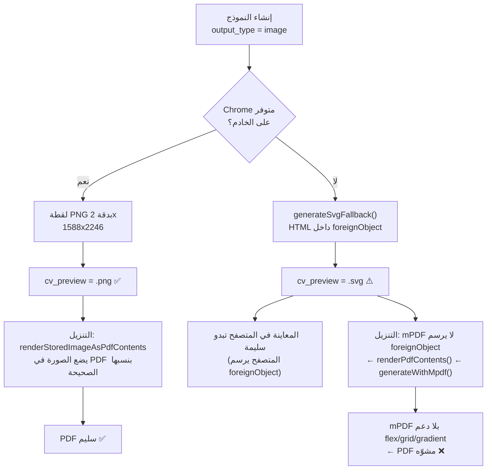

# توليد نموذج السيرة الذاتية وتصديره PDF

> يشرح لماذا يخرج تنزيل «نموذج PDF» مشوّهًا، وكيف يُصلح على الخادم.
> يخصّ [MaidCvPdfGenerator](../app/Services/ingaz/MaidCvPdfGenerator.php) وشاشة `/admin/maids`.

---

## المشكلة

عند الضغط على **الإجراءات ← تنزيل النموذج PDF** يخرج ملف مشوّه: الشعار متداخل مع النص،
والتنسيق مكسور، وصفحتان بدل صفحة واحدة — بينما تبدو المعاينة داخل الداشبورد سليمة تمامًا.

## السبب

القالب المخزّن في قاعدة البيانات (~68KB CSS) يعتمد على **flexbox و grid و gradients**.
المحرّك الوحيد الذي يرسمه بشكل صحيح هو متصفح حقيقي.



سلسلة السقوط في الكود:

| الخطوة | الملف |
|---|---|
| 1. `generateImageOutput()` لا يجد المتصفح فيستدعي `generateSvgFallback()` | [MaidCvPdfGenerator.php](../app/Services/ingaz/MaidCvPdfGenerator.php#L237) |
| 2. التنزيل يكتشف `<foreignObject>` فيستدعي `renderForeignObjectSvgAsPdfContents()` | [MaidCvPdfGenerator.php](../app/Services/ingaz/MaidCvPdfGenerator.php#L363) |
| 3. لا يجد المتصفح مجددًا فيسقط إلى `renderPdfContents()` ← `generateWithMpdf()` | [MaidCvPdfGenerator.php](../app/Services/ingaz/MaidCvPdfGenerator.php#L386) |

كل ذلك يحدث **بصمت** — لا خطأ يظهر للأدمن، فقط ملف رديء.

---

## التشخيص

```bash
php artisan cv:doctor              # فحص الإعدادات والمتصفح والنماذج المخزّنة
php artisan cv:doctor --maid=512   # يضيف تجربة لقطة متصفح فعلية دون الكتابة في قاعدة البيانات
```

المؤشّر الحاسم في المخرَج هو امتداد النماذج المخزّنة:

- `.png` ← المتصفح يعمل، والتنزيل سيخرج سليمًا.
- `.svg` ← المتصفح غير متوفر وقت الإنشاء، وتنزيل هذه النماذج سيخرج مشوّهًا.

---

## الإصلاح على الخادم

### 1. تثبيت متصفح **غير** snap

```bash
# Ubuntu / Debian — الأفضل: Chrome كحزمة deb
cd /tmp
wget https://dl.google.com/linux/direct/google-chrome-stable_current_amd64.deb
sudo apt install -y ./google-chrome-stable_current_amd64.deb
sudo apt install -y fonts-noto-core fonts-liberation

# CentOS / RHEL / AlmaLinux
sudo dnf install -y chromium
```

> **لا تستخدم snap.** الحزمة `chromium-browser` على أوبنتو الحديث مجرد غلاف لـ snap،
> و snap يرفض العمل بمستخدم خدمة مثل `www-data`:
>
> ```
> cannot create snap home dir: mkdir /var/www/snap: permission denied
> ... is not a snap cgroup for tag snap.chromium.chromium
> ```
>
> للتأكّد مما هو مثبّت: `readlink -f /usr/bin/chromium-browser` و`snap list | grep chromium`.

تحقّق من المسار وأنه يعمل:

```bash
which chromium || which chromium-browser || which google-chrome
chromium --headless=new --disable-gpu --screenshot=/tmp/t.png about:blank && ls -l /tmp/t.png
```

> الخطوط العربية مطلوبة أيضًا، وإلا ظهرت مربّعات فارغة:
> `sudo apt-get install -y fonts-noto-core fonts-noto-color-emoji`

### 2. ضبط المسار (اختياري)

البحث التلقائي يغطي المسارات الشائعة (`/usr/bin/chromium`، `/usr/bin/google-chrome`، `/snap/bin/chromium` …).
حدّد المسار صراحةً فقط إذا كان غير قياسي:

```env
CV_PDF_BROWSER_PATH=/usr/bin/chromium
```

ثم:

```bash
php artisan optimize:clear
```

> **مهم:** كانت هذه القيمة تُقرأ بـ `env()` مباشرةً داخل الخدمة، فتصبح `null` بعد
> `php artisan config:cache` في الإنتاج. صارت تُقرأ الآن من
> [config/services.php](../config/services.php) عبر `config('services.chrome.path')`.

### 3. التأكّد من `proc_open`

بعض إعدادات الاستضافة تعطّلها في `php.ini`:

```bash
php -r "var_dump(function_exists('proc_open'));"
```

يجب أن تكون `true`، وإلا فلن يُشغَّل المتصفح إطلاقًا. أزلها من `disable_functions`.

### 4. التحقّق ثم إعادة إنشاء النماذج القديمة

```bash
php artisan cv:doctor --maid=<أي_معرّف>
```

بعد ظهور `[v] نجحت لقطة المتصفح`، أعد إنشاء النماذج المحفوظة كـ `.svg` من الداشبورد
عبر **الإنشاء الجماعي** (`maids.generate-cv.bulk`) أو زر **إعادة إنشاء النموذج** لكل عاملة.
عندها يصبح `cv_preview` ملف `.png`، ويخرج التنزيل PDF سليمًا تلقائيًا دون أي تغيير إضافي.

---

---

## خلاصة النشر على خادم جديد

نُفِّذت هذه الخطوات بنجاح على `dashboard.tawssut.sa` بتاريخ 2026-09-01.
شغّلها بالترتيب على كل خادم. **بدّل `www-data` بمستخدم PHP-FPM الفعلي إن اختلف.**

```bash
cd /var/www/<اسم_المشروع>

# ── 0) تعرّف على مستخدم PHP-FPM ─────────────────────────────
ps -eo user,comm | grep -E "php-fpm|nginx|apache2" | sort -u

# ── 1) نشر الكود ────────────────────────────────────────────
git pull

# ── 2) صلاحيات التخزين ──────────────────────────────────────
# Blade يصرّف قالب السيرة (المخزّن في قاعدة البيانات) إلى ملف مؤقت
# داخل storage/framework/views قبل تنفيذه.
sudo chown -R www-data:www-data storage bootstrap/cache
sudo find storage bootstrap/cache -type d -exec chmod 775 {} \;
sudo find storage bootstrap/cache -type f -exec chmod 664 {} \;

# ── 3) تثبيت Chrome كحزمة deb (وليس snap) ───────────────────
readlink -f /usr/bin/chromium-browser 2>/dev/null   # إن أشار إلى snap فتجاهله
cd /tmp
wget -q https://dl.google.com/linux/direct/google-chrome-stable_current_amd64.deb
sudo apt install -y ./google-chrome-stable_current_amd64.deb
sudo apt install -y fonts-noto-core fonts-liberation
cd -

# ── 4) تثبيت المسار في .env ─────────────────────────────────
grep -q '^CV_PDF_BROWSER_PATH=' .env \
  && sudo -u www-data sed -i 's|^CV_PDF_BROWSER_PATH=.*|CV_PDF_BROWSER_PATH=/usr/bin/google-chrome|' .env \
  || echo 'CV_PDF_BROWSER_PATH=/usr/bin/google-chrome' | sudo -u www-data tee -a .env

# ── 5) مسح الكاش والتحقق ────────────────────────────────────
sudo -u www-data php artisan optimize:clear
sudo -u www-data php artisan cv:doctor --maid=<أي_معرّف_عاملة>
```

المطلوب في المخرَج: `[v]` على كل الفحوصات و`[v] نجحت لقطة المتصفح`.

**الخطوة الأخيرة:** أعد إنشاء النماذج المحفوظة كـ `.svg` من الداشبورد عبر **الإنشاء الجماعي**،
على دفعات صغيرة (~6–8 ثوانٍ لكل سيرة). بعدها يخرج «تنزيل النموذج PDF» سليمًا.

> **قاعدة دائمة:** شغّل كل أوامر artisan على الخوادم بـ `sudo -u www-data php artisan …`.
> تشغيلها كـ root يجعل الملفات المصرَّفة في `storage` و`bootstrap/cache` مملوكة لـ root
> فيتكرّر خطأ `Permission denied` من جديد.

---

## أخطاء شائعة ومعانيها

| الرسالة في `cv:doctor` أو في المتصفح | السبب | الحل |
|---|---|---|
| `file_put_contents(.../storage/framework/views/...): Permission denied` | القالب مخزّن كنصّ في قاعدة البيانات، و`Blade::render()` يجب أن يكتبه ملفًا مصرَّفًا قبل تنفيذه | `sudo chown -R www-data:www-data storage bootstrap/cache` — وشغّل artisan دائمًا بـ `sudo -u www-data` |
| `cannot create snap home dir: mkdir /var/www/snap` | المتصفح مثبّت عبر snap ولا يعمل بمستخدم خدمة | ثبّت Chrome كحزمة deb (القسم أعلاه) |
| `mkdir: cannot create directory '/var/www/.local'` + `chrome_crashpad_handler: --database is required` (كود الخروج 133) | `$HOME` لمستخدم `www-data` هو `/var/www` غير القابل للكتابة | مُعالَج في الكود: تُمرَّر `HOME` و`XDG_*` مؤقتة داخل مجلد العملية |
| `لم يُعثر على Chrome/Chromium على هذا الخادم` | لا متصفح، أو مسار غير قياسي | ثبّته، أو اضبط `CV_PDF_BROWSER_PATH` |
| `proc_open معطّلة في php.ini` | الاستضافة تعطّلها | أزلها من `disable_functions` |

## ملاحظات

- التوليد يستغرق ~6–8 ثوانٍ لكل سيرة. الإنشاء الجماعي لعدد كبير يحتاج رفع
  `max_execution_time` أو تشغيله عبر CLI.
- مقاس اللقطة يُضبط بـ `CV_IMAGE_VIEWPORT_WIDTH` / `CV_IMAGE_VIEWPORT_HEIGHT`
  (افتراضيًا 794×1123 = A4 بدقة 96dpi)، وتُلتقط بـ `--force-device-scale-factor=2`
  فتخرج 1588×2246.
- [`renderPdfContents()`](../app/Services/ingaz/MaidCvPdfGenerator.php) هو مسار mPDF
  الاحتياطي. لا يُستدعى إلا من `renderForeignObjectSvgAsPdfContents()` عند غياب
  المتصفح — أي أن ظهوره في المخرَجات دليل على المشكلة نفسها.
