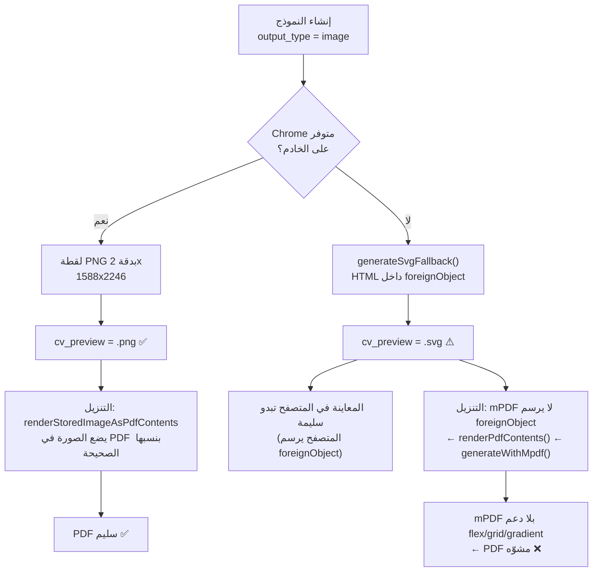

# توليد نموذج السيرة الذاتية وتصديره PDF

> يشرح لماذا يخرج تنزيل «نموذج PDF» مشوّهًا، وكيف يُصلح على الخادم.
> يخصّ [MaidCvPdfGenerator](../app/Services/ingaz/MaidCvPdfGenerator.php) وشاشة `/admin/maids`.

---

## المشكلة

عند الضغط على **الإجراءات ← تنزيل النموذج PDF** يخرج ملف مشوّه: الشعار متداخل مع النص،
والتنسيق مكسور، وصفحتان بدل صفحة واحدة — بينما تبدو المعاينة داخل الداشبورد سليمة تمامًا.

## السبب

القالب المخزّن في قاعدة البيانات (~68KB CSS) يعتمد على **flexbox و grid و gradients**.
المحرّك الوحيد الذي يرسمه بشكل صحيح هو متصفح حقيقي.



سلسلة السقوط في الكود:

| الخطوة | الملف |
|---|---|
| 1. `generateImageOutput()` لا يجد المتصفح فيستدعي `generateSvgFallback()` | [MaidCvPdfGenerator.php](../app/Services/ingaz/MaidCvPdfGenerator.php#L237) |
| 2. التنزيل يكتشف `<foreignObject>` فيستدعي `renderForeignObjectSvgAsPdfContents()` | [MaidCvPdfGenerator.php](../app/Services/ingaz/MaidCvPdfGenerator.php#L363) |
| 3. لا يجد المتصفح مجددًا فيسقط إلى `renderPdfContents()` ← `generateWithMpdf()` | [MaidCvPdfGenerator.php](../app/Services/ingaz/MaidCvPdfGenerator.php#L386) |

كل ذلك يحدث **بصمت** — لا خطأ يظهر للأدمن، فقط ملف رديء.

---

## التشخيص

```bash
php artisan cv:doctor              # فحص الإعدادات والمتصفح والنماذج المخزّنة
php artisan cv:doctor --maid=512   # يضيف تجربة لقطة متصفح فعلية دون الكتابة في قاعدة البيانات
```

المؤشّر الحاسم في المخرَج هو امتداد النماذج المخزّنة:

- `.png` ← المتصفح يعمل، والتنزيل سيخرج سليمًا.
- `.svg` ← المتصفح غير متوفر وقت الإنشاء، وتنزيل هذه النماذج سيخرج مشوّهًا.

---

## الإصلاح على الخادم

### 1. تثبيت Chromium

```bash
# Ubuntu / Debian
sudo apt-get update
sudo apt-get install -y chromium-browser fonts-liberation
# إن لم تتوفر الحزمة:  sudo snap install chromium

# CentOS / RHEL / AlmaLinux
sudo dnf install -y chromium
```

تحقّق من المسار وأنه يعمل:

```bash
which chromium || which chromium-browser || which google-chrome
chromium --headless=new --disable-gpu --screenshot=/tmp/t.png about:blank && ls -l /tmp/t.png
```

> الخطوط العربية مطلوبة أيضًا، وإلا ظهرت مربّعات فارغة:
> `sudo apt-get install -y fonts-noto-core fonts-noto-color-emoji`

### 2. ضبط المسار (اختياري)

البحث التلقائي يغطي المسارات الشائعة (`/usr/bin/chromium`، `/usr/bin/google-chrome`، `/snap/bin/chromium` …).
حدّد المسار صراحةً فقط إذا كان غير قياسي:

```env
CV_PDF_BROWSER_PATH=/usr/bin/chromium
```

ثم:

```bash
php artisan optimize:clear
```

> **مهم:** كانت هذه القيمة تُقرأ بـ `env()` مباشرةً داخل الخدمة، فتصبح `null` بعد
> `php artisan config:cache` في الإنتاج. صارت تُقرأ الآن من
> [config/services.php](../config/services.php) عبر `config('services.chrome.path')`.

### 3. التأكّد من `proc_open`

بعض إعدادات الاستضافة تعطّلها في `php.ini`:

```bash
php -r "var_dump(function_exists('proc_open'));"
```

يجب أن تكون `true`، وإلا فلن يُشغَّل المتصفح إطلاقًا. أزلها من `disable_functions`.

### 4. التحقّق ثم إعادة إنشاء النماذج القديمة

```bash
php artisan cv:doctor --maid=<أي_معرّف>
```

بعد ظهور `[v] نجحت لقطة المتصفح`، أعد إنشاء النماذج المحفوظة كـ `.svg` من الداشبورد
عبر **الإنشاء الجماعي** (`maids.generate-cv.bulk`) أو زر **إعادة إنشاء النموذج** لكل عاملة.
عندها يصبح `cv_preview` ملف `.png`، ويخرج التنزيل PDF سليمًا تلقائيًا دون أي تغيير إضافي.

---

## ملاحظات

- التوليد يستغرق ~6–8 ثوانٍ لكل سيرة. الإنشاء الجماعي لعدد كبير يحتاج رفع
  `max_execution_time` أو تشغيله عبر CLI.
- مقاس اللقطة يُضبط بـ `CV_IMAGE_VIEWPORT_WIDTH` / `CV_IMAGE_VIEWPORT_HEIGHT`
  (افتراضيًا 794×1123 = A4 بدقة 96dpi)، وتُلتقط بـ `--force-device-scale-factor=2`
  فتخرج 1588×2246.
- [`renderPdfContents()`](../app/Services/ingaz/MaidCvPdfGenerator.php) هو مسار mPDF
  الاحتياطي. لا يُستدعى إلا من `renderForeignObjectSvgAsPdfContents()` عند غياب
  المتصفح — أي أن ظهوره في المخرَجات دليل على المشكلة نفسها.
