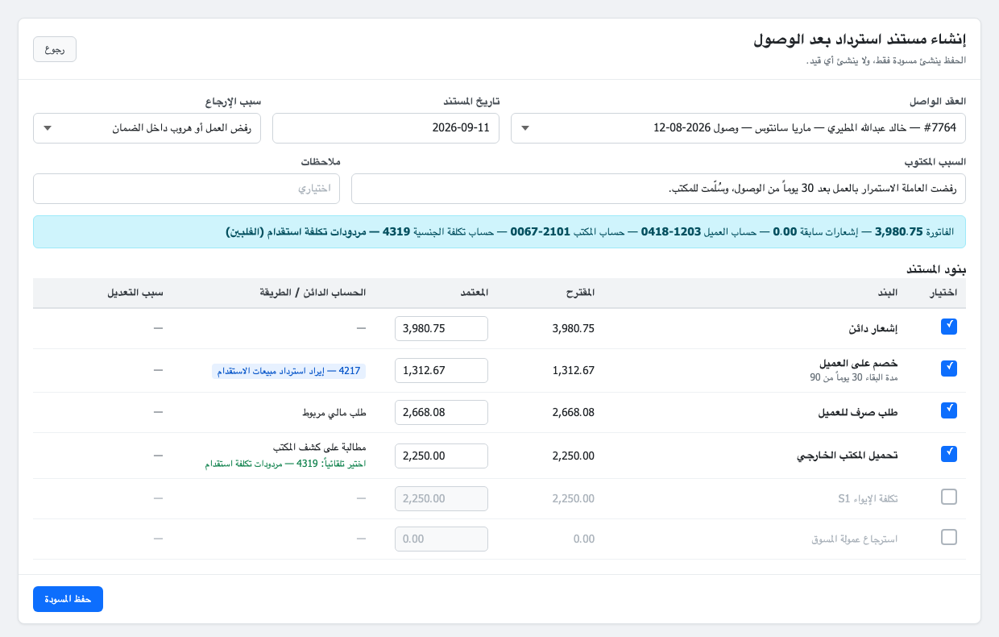
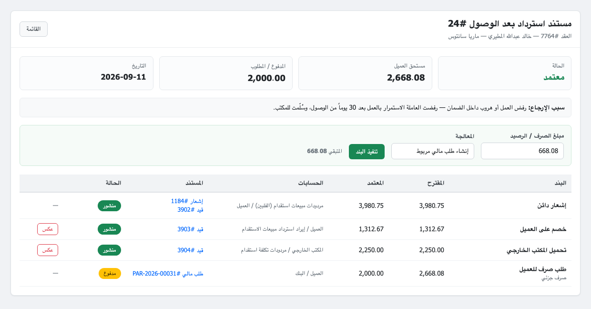

# تحديث النظام: الاسترداد بعد الوصول

**تاريخ التحديث:** 2026-09-24 · **موجّه إلى:** المحاسب ومدير المالية

> **الفكرة في سطر:** كل حالة إرجاع بعد وصول العاملة صار لها **مستند واحد** يراجعه المحاسب ويعتمده. لا ينشأ أي قيد قبل الاعتماد. أما الاسترداد قبل الوصول فلم يتغير.

## ما الجديد

- **شاشة مستقلة:** المالية ← «الاسترداد بعد الوصول». كل حالة في مستند واحد بدل قيود متفرقة.
- **لا قيود تلقائية:** الموافقة على طلب الإرجاع أو دخول العاملة إلى الإيواء لم تعد تنشئ قيوداً.
- **المحاسب يقرر:** النظام يقترح المبالغ، والمحاسب يقبل أو يعدّل أو يحذف البند.
- **تحميل المكتب الخارجي يدوي:** لا يُحمَّل المكتب تلقائياً بعد اليوم.
- **صرف مرن:** طلب مالي مربوط بالمستند، كاملاً أو على دفعات، مع إظهار المتبقي.

## خطوة 1: إنشاء المسودة

يختار المحاسب العقد وتاريخ المستند وسبب الإرجاع، فتظهر البنود بمبالغها المقترحة جاهزة للمراجعة. **الحفظ في هذه المرحلة لا ينشئ أي قيد.**



في المثال أعلاه: فاتورة 3,980.75 ريال، أُرجعت العاملة بعد 30 يوماً من الوصول والضمان 90 يوماً. النظام اقترح خصم مدة البقاء 1,312.67 وصافي مستحق للعميل 2,668.08 وتحميل المكتب 2,250.00. المحاسب استبعد بندي الإيواء وعمولة المسوق بإلغاء تحديدهما.

## خطوة 2: الاعتماد والصرف

بعد المراجعة يضغط المحاسب **«اعتماد ونشر البنود»**، فتُنشأ القيود والإشعار الدائن. ثم يصرف للعميل بطلب مالي، كاملاً أو على دفعات.



كل بند يعرض رقم قيده أو إشعاره أو طلبه المالي مع رابط مباشر، وحالته، وزر عكس مستقل. في المثال صُرف 2,000.00 من أصل 2,668.08، فبقي 668.08 وأصبح المستند «مسدد جزئياً».

## القيود الناتجة باختصار

| # | البند | مدين | دائن | المبلغ |
|---|---|---|---|---:|
| 1 | إشعار دائن | مردودات مبيعات استقدام + الضريبة | العميل | 3,980.75 |
| 2 | خصم مدة البقاء | العميل | إيراد استرداد مبيعات الاستقدام | 1,312.67 |
| 3 | تحميل المكتب الخارجي | المكتب الخارجي | مردودات تكلفة الاستقدام | 2,250.00 |
| 4 | صرف العميل | العميل | البنك / الصندوق | 2,668.08 |

القيد الرابع ينشأ عند إغلاق الطلب المالي لا عند اعتماد المستند. وإذا بقيت العاملة في الإيواء ولم يُحمَّل المكتب، يُستبدل القيد الثالث بقيد رسملة: مدين «مصروفات مدفوعة مقدماً - إيواء» / دائن مردودات تكلفة الاستقدام. رصيد العميل بعد اكتمال الخطوات يعود إلى صفر.

## الاسترداد قبل الوصول: لم يتغير

يبقى من نافذة «استرداد العقد» كما اعتدتم، بإشعار دائن بكامل الفاتورة، وقيد غرامة عند وجود تحويل مساند والمتسبب هو العميل: مدين العميل / دائن غرامات إلغاء عقود الاستقدام.

| الأيام من تاريخ العقد | نسبة الغرامة |
|---|---:|
| حتى 5 أيام | 0% |
| 6 إلى 60 يوماً | 5% |
| 61 إلى 90 يوماً | 10% |
| 91 إلى 120 يوماً | 15% |
| أكثر من 120 يوماً | 20% |

إذا كان المتسبب هو المكتب فلا غرامة ويسترد العميل كامل المبلغ. وإذا أدخلتم تاريخاً بعد الوصول، يحوّلكم النظام تلقائياً إلى الشاشة الجديدة.

## تصحيح الأخطاء

أي بند يُعكس منفرداً من زر «عكس» بسبب مكتوب، دون المساس ببقية البنود. الاستثناءان: **الإشعار الدائن** يُعالج بإشعار مدين نظامي لأنه مستند ضريبي، و**الطلب المالي** لا يُعكس بعد اعتماده أو دفعه.

## التفعيل: أوامر جاهزة للتنفيذ

### 1) بعد تحديث النسخة — مرة واحدة

```bash
cd /home/platinum/public_html
php artisan migrate --force
php artisan permissions:prepare-server --role-id=1 --role-name=Administrator --attach-first-admin
php artisan permission:cache-reset
php artisan optimize:clear
```

هذه الأوامر تنشئ جداول المستند وصفوف الصلاحيات الخمس، وتمنحها لدور المدير، وتُظهرها في شاشة الأدوار. استبدل `1` برقم دور المدير لديكم إن كان مختلفاً. يجب أن ينتهي خرج الأمر الثالث بالسطرين:

```text
Missing selected: 0
Route required unregistered: 0
```

### 2) منح الصلاحيات لدور المحاسب

```bash
php artisan permissions:assign-post-arrival-refunds --role="ROLE_NAME" --dry-run
php artisan permissions:assign-post-arrival-refunds --role="ROLE_NAME"
php artisan permission:cache-reset
```

ضع مكان `ROLE_NAME` اسم دور المحاسب كما يظهر في شاشة الأدوار بالضبط، بين علامتي اقتباس. الأمر الأول معاينة لا تعدّل شيئاً ويعرض الصلاحيات والدور المستهدف، ونفّذ الثاني بعد التأكد. ولمنح الصلاحيات لموظف بعينه بدل الدور، ضع رقمه مكان `12`:

```bash
php artisan permissions:assign-post-arrival-refunds --admin=12
php artisan permission:cache-reset
```

### 3) التحقق

افتح شاشة صلاحيات الدور وتأكد من ظهور الصلاحيات الخمس محددة:

```text
https://YOUR-DOMAIN/dash/perms/ROLE_ID
```

### الصلاحيات الخمس وما تمنحه

| الصلاحية | تمنح |
|---|---|
| `post_arrival_refund_view` | فتح الشاشة وعرض المستندات |
| `post_arrival_refund_create` | إنشاء مسودة وتعديل بنودها |
| `post_arrival_refund_post` | اعتماد المستند ونشر القيود |
| `post_arrival_refund_payout` | إنشاء طلب الصرف للعميل |
| `post_arrival_refund_reverse` | عكس بند منشور |

يُنصح بفصل صلاحيتي **الاعتماد** و**العكس** عن صلاحية الإنشاء، فيُنشئ الموظف المسودة ويعتمدها مسؤول أعلى.

### إعدادات الحسابات قبل أول مستند

- ربط كل عميل بحساب محاسبي طرفي.
- حسابات الجنسيات: مردودات تكلفة الاستقدام، ومصروفات مدفوعة مقدماً للإيواء.
- حساب إيراد خصم مدة البقاء، وحساب غرامات إلغاء العقود.
- وجود سنة مالية نشطة.

فريق الدعم جاهز لتنفيذ الأوامر معكم ومراجعة الحسابات قبل أول مستند.

*للتفاصيل المحاسبية الكاملة: «تقرير تحديث الاسترداد قبل وبعد الوصول والمطلوب من المحاسب».*
